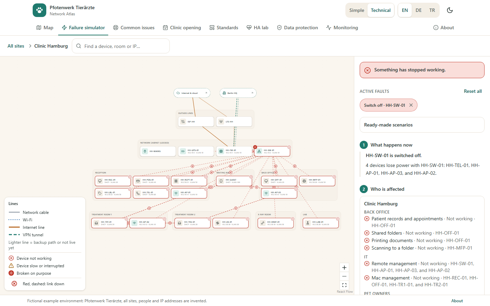
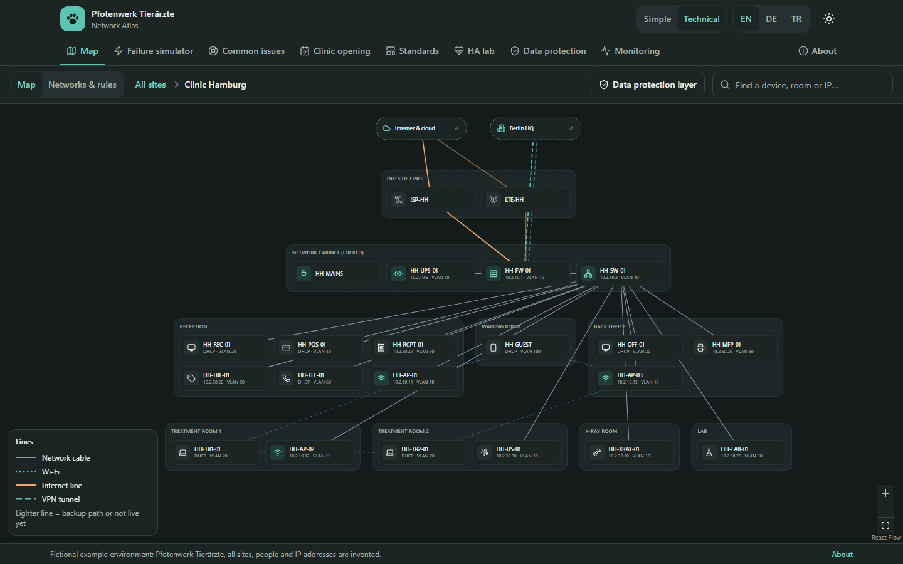

# Vet Clinic Network Atlas

[English](README.md) · **Deutsch**

Ein interaktiver Atlas der IT von **Pfotenwerk Tierärzte**, einer fiktiven Tierarztpraxis-Kette mit Zentrale in
Berlin und Praxen in Berlin, Hamburg und München. Er zeigt, wie das Netz aufgebaut ist, was passiert, wenn Teile
davon ausfallen, und wie die IT im Alltag arbeitet: Fehlersuche, Eröffnung einer neuen Praxis, Standards,
Hochverfügbarkeit, Datenschutz und Monitoring.

Jede Ansicht gibt es auf Englisch, Deutsch und Türkisch, im hellen und dunklen Design und in zwei Stufen:
**Einfach** für Praxisteams und Leitung, **Technisch** für die IT.



> **Fiktive Umgebung.** Firma, Standorte, Personen, Hostnamen und IP-Adressen sind erfunden. Die IP-Adressen
> stammen aus privaten Bereichen und den Dokumentationsbereichen (RFC 5737). Lieferzeiten, Preise und
> Aufbewahrungsfristen sind gekennzeichnete Platzhalter, keine realen Angaben.

## Module

| | Modul | Was man tun kann |
|---|---|---|
| A | Netzwerkkarte | Deutschlandübersicht, dann jeder Standort bis zum Raum und Gerät. VLAN-Plan und Firewall-Regeln. |
| B | Ausfallsimulator | Geräte ausschalten, Leitungen kappen, Dienste stoppen. Die Engine kennt die Redundanz und erklärt, wer betroffen ist, was zu prüfen ist und wie man es behebt. |
| C | Häufige Probleme | 18 typische Praxis-Tickets mit wahrscheinlichen Ursachen, Prüfschritten in Reihenfolge und Lösung. |
| D | Neue Praxis eröffnen | Playbook für München von der Begehung bis zur Hypercare, mit Beschaffungssimulation. Abgehakt, geht die Praxis auf der Karte live. |
| E | Standardisierung | Ein Hardware-Kit, ein Standort-Template, gestaffelter Firmware-Rollout und Ansible. |
| F | HA-Labor | Ein vSphere-Cluster mit drei Hosts: HA-Neustart, N+1-Admission-Control, Wartungsmodus, vMotion. |
| G | Datenschutz | Wo personenbezogene Daten liegen und wie sie geschützt sind, auch als Ebene auf der Karte. |
| H | Monitoring | Ein Statusboard, das vom Simulator gespeist wird, ein Bereitschaftsbeispiel, Frühwarnungen und der Release-Ablauf. |



## Lokal starten

Benötigt Node.js 20 oder neuer.

```bash
npm install
npm run dev        # http://localhost:5173
```

| Befehl | Was er tut |
|---|---|
| `npm run build` | Typprüfung und Build der statischen Seite nach `dist/` |
| `npm run preview` | Die gebaute Seite ausliefern |
| `npm run check` | Typprüfung, Lint, Tests und Datenprüfung in einem Lauf |
| `npm run validate-data` | Jede Datendatei, jeden Querverweis und jede Übersetzung prüfen |

## Veröffentlichen auf GitHub Pages

Der Workflow `.github/workflows/deploy.yml` prüft, baut und veröffentlicht bei jedem Push auf `main`. Er setzt den
Basispfad aus dem Repository-Namen, damit die Seite unter `https://<user>.github.io/<repo>/` läuft.

Einmalig einrichten: **Settings → Pages → Build and deployment → Source: GitHub Actions**.

Die Seite ist vollständig statisch: kein Backend, kein Login, keine Anfragen zur Laufzeit. Die Routen nutzen den
URL-Hash (`#/simulator`), daher funktionieren Direktlinks auf GitHub Pages ohne 404-Umleitung.

## Aufbau

- **Daten statt Code.** Netz, Ausfallszenarien, Tickets, Playbook, Standards, Datenschutzmaßnahmen und
  Monitoring-Werte liegen als JSON in `src/data/`. Jede Datei wird mit zod und Querverweis-Regeln geprüft, im
  Browser und in der CI.
- **Reine Simulations-Engine.** `src/engine/simulate.ts` nimmt die Topologie und eine Menge von Fehlern und liefert
  den Zustand jedes Geräts, jeder Verbindung und jedes Dienstes. Sie folgt redundanten Wegen (zweite WAN-Leitung,
  LTE-Backup, Firewall- und Switch-Paare, Cluster-Hosts) und ordnet jeden Ausfall seiner Ursache zu.
- **Übersetzungen.** `src/i18n/<lang>/<namespace>.json`. Die Schlüssel sind typisiert; die Prüfung schlägt bei
  fehlenden Schlüsseln, abweichenden Platzhaltern oder zu langen Texten fehl.
- **Stack.** React 18, TypeScript (strict), Vite, React Flow, Tailwind CSS 4, zod, lucide-react, Vitest.

```
src/
  data/        JSON-Inhalte und der geladene, geprüfte Index
  schema/      zod-Schemas und Querverweis-Prüfung
  engine/      Ausfallsimulation, Erklärungen, HA-Platzierung
  modules/     ein Ordner pro Modul (a-map … h-monitoring, about)
  components/  Layout, Karten-Canvas, gemeinsame UI
  i18n/        Wörterbücher für en / de / tr
scripts/       validate-data
docs/          SCHEMA.md (Datenformate), REUSE.md (Herkunft des Codes)
```

Wer das Netz ändern oder ein Ausfallszenario ergänzen will, bearbeitet meist nur JSON. Die Formate beschreibt
[docs/SCHEMA.md](docs/SCHEMA.md) (auf Englisch).
