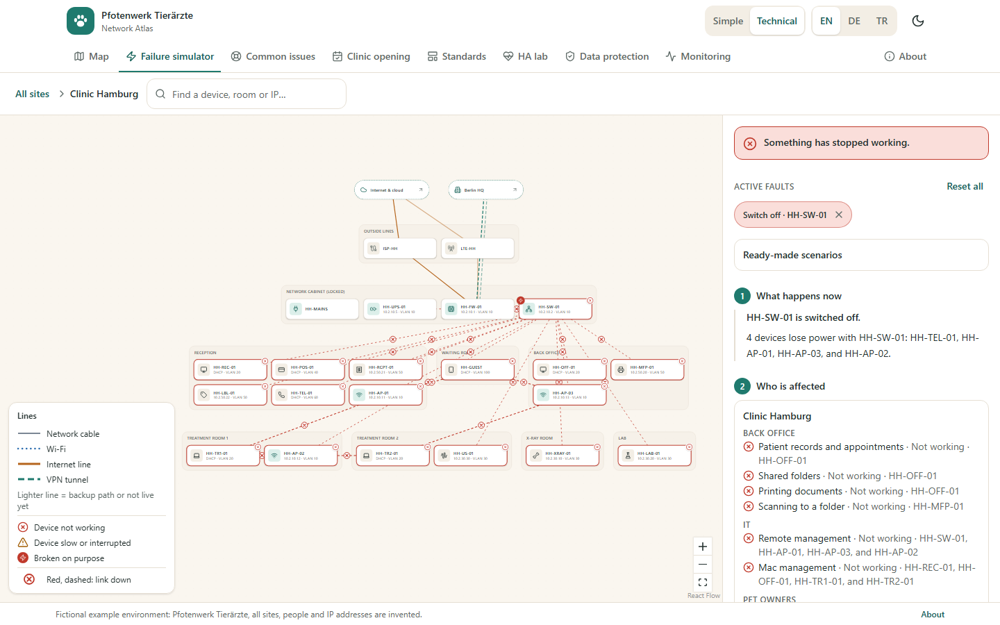
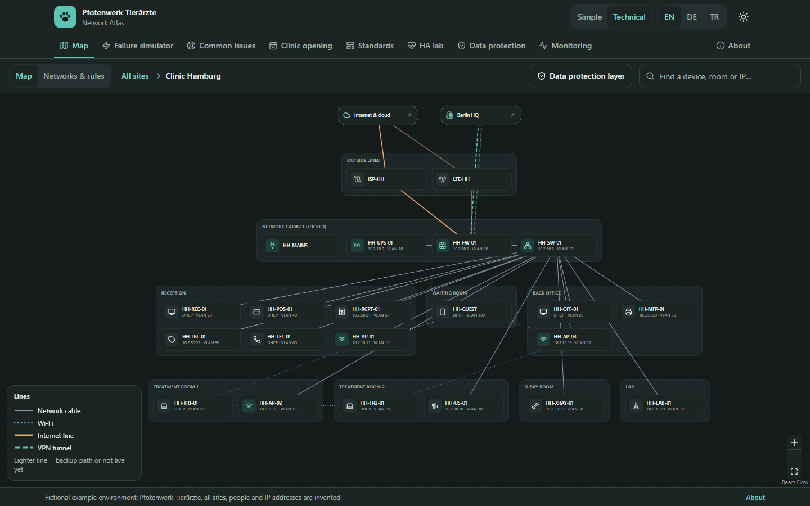

# Vet Clinic Network Atlas

**English** · [Deutsch](README.de.md)

**[Live demo](https://barisbalciweb.github.io/vet-clinic-network-atlas/)**

An interactive atlas of the IT of **Pfotenwerk Tierärzte**, a fictional veterinary clinic chain with a head office in
Berlin and clinics in Berlin, Hamburg and München. It shows how the network is built, what happens when parts of it
fail, and how IT runs day to day: troubleshooting, opening a new clinic, standards, high availability, data
protection and monitoring.

Every screen is available in English, German and Turkish, in a light and a dark theme, and in two views: **Simple**
for clinic staff and managers, **Technical** for IT.



> **Fictional environment.** The company, sites, people, hostnames and IP addresses are invented. IP addresses come
> from private ranges and the documentation ranges (RFC 5737). Lead times, prices and retention periods are
> labelled placeholders, not real-world facts.

## Modules

| | Module | What you can do |
|---|---|---|
| A | Network map | Germany overview, then every site down to the room and device. VLAN plan and firewall rules. |
| B | Failure simulator | Switch off devices, cut lines, stop services. The engine knows about redundancy and explains who is affected, what to test and how to fix it. |
| C | Common issues | 26 typical clinic tickets with likely causes, checks in order and the solution; card payment in depth, with the mistakes that make things worse. |
| D | New clinic opening | Playbook for München from site survey to hypercare, with a procurement simulation. Tick it off and the clinic goes live on the map. |
| E | Standardization | One hardware kit, one site template, a staged firmware rollout and Ansible. |
| F | HA lab | A three-host vSphere cluster: HA restarts, N+1 admission control, maintenance mode, vMotion. |
| G | Data protection | Where personal data lives and how it is protected, also as a layer on the map. |
| H | Monitoring | A status board fed by the simulator, an on-call example, early warnings and the release process. |



## Run it locally

Requires Node.js 20 or newer.

```bash
npm install
npm run dev        # http://localhost:5173
```

| Command | What it does |
|---|---|
| `npm run build` | Type-check and build the static site into `dist/` |
| `npm run preview` | Serve the built site |
| `npm run check` | Type-check, lint, tests and data validation, all in one go |
| `npm run validate-data` | Check every data file, every cross-reference and every translation |

## Deploy to GitHub Pages

The workflow in `.github/workflows/deploy.yml` checks, builds and publishes on every push to `main`. It sets the
base path from the repository name, so the site works under `https://<user>.github.io/<repo>/`.

One-time setup: **Settings → Pages → Build and deployment → Source: GitHub Actions**.

The site is fully static: no backend, no login, no requests at runtime. Routes use the URL hash (`#/simulator`),
so deep links work on GitHub Pages without a 404 fallback.

## How it is built

- **Data, not code.** The network, failure scenarios, tickets, playbook, standards, privacy measures and monitoring
  values live in JSON files in `src/data/`. Each file is checked with zod plus cross-reference rules, in the browser
  and in CI.
- **Pure simulation engine.** `src/engine/simulate.ts` takes the topology and a set of faults and returns the state
  of every device, link and service. It follows redundant paths (second WAN line, LTE backup, firewall and switch
  pairs, cluster hosts) and attributes every outage to its cause.
- **Translations.** `src/i18n/<lang>/<namespace>.json`. Keys are typed; validation fails on missing keys,
  mismatched placeholders or texts that are too long.
- **Stack.** React 18, TypeScript (strict), Vite, React Flow, Tailwind CSS 4, zod, lucide-react, Vitest.

```
src/
  data/        JSON content and the loaded, validated index
  schema/      zod schemas and cross-reference validation
  engine/      failure simulation, explanations, HA placement
  modules/     one folder per module (a-map … h-monitoring, about)
  components/  layout, map canvas, shared UI
  i18n/        dictionaries for en / de / tr
scripts/       validate-data
docs/          SCHEMA.md (data formats), REUSE.md (origin of the code)
```

Changing the network or adding a fault scenario usually means editing JSON only. The formats are described in
[docs/SCHEMA.md](docs/SCHEMA.md).

## Credits

Built by **Barış Balcı** ([@barisbalciweb](https://github.com/barisbalciweb)).
